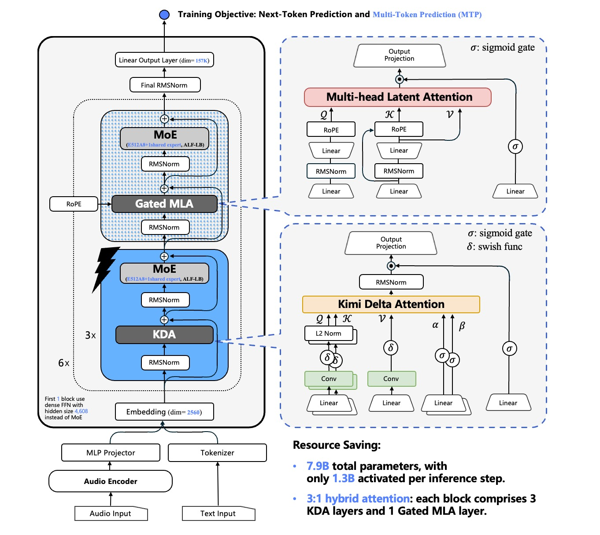
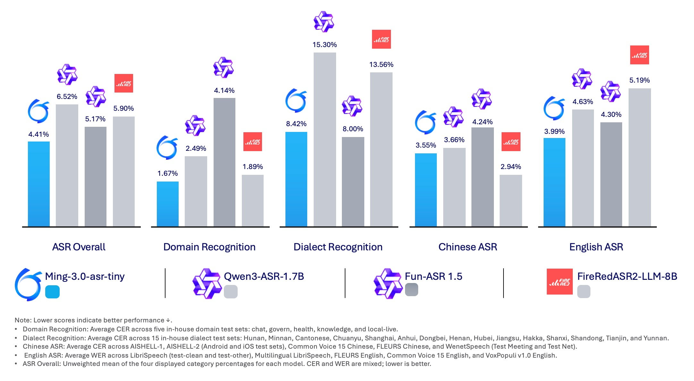
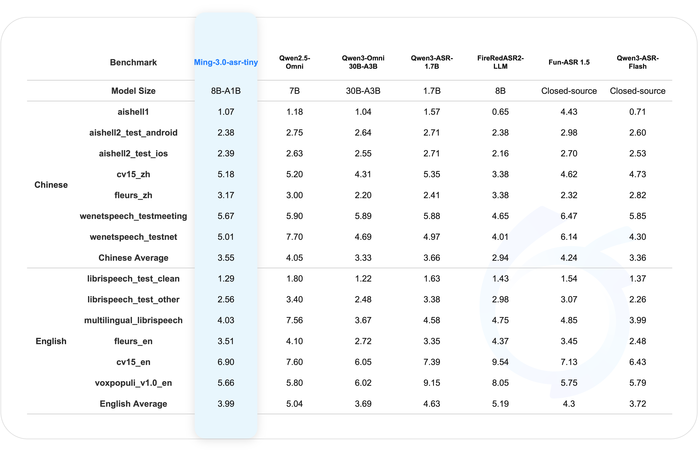
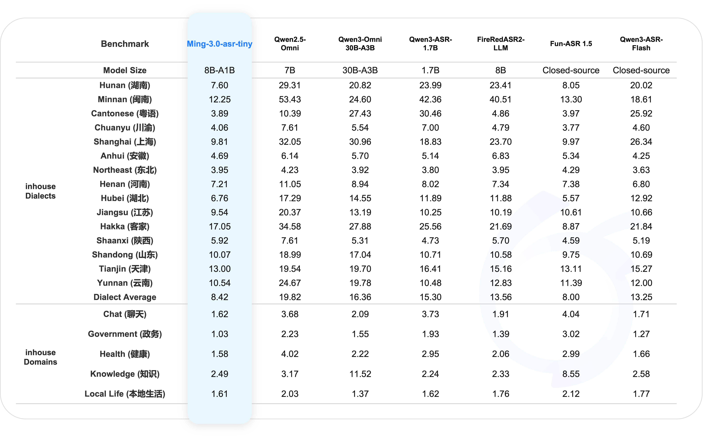
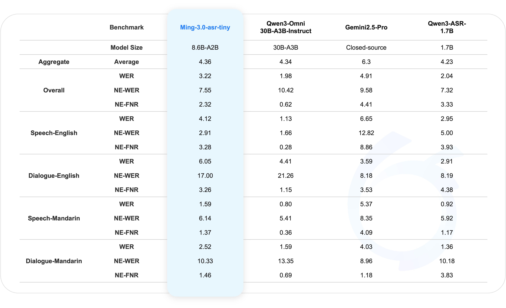

<p align="center">
  
</p>

<h1 align="center">Ming-3.0-asr-tiny: Context-Aware Speech Recognition</h1>

<p align="center"><i>Chinese and English · Dialects · Hotwords and Dialogue Context</i></p>

<p align="center">
  <a href="https://huggingface.co/inclusionAI/Ming-3.0-asr-tiny"><b>Hugging Face</b></a>
  &nbsp;·&nbsp; <a href="#quick-start"><b>Quick Start</b></a>
  &nbsp;·&nbsp; <a href="#cookbook"><b>Cookbook</b></a>
  &nbsp;·&nbsp; <a href="#evaluation"><b>Evaluation</b></a>
</p>

## Beyond Word-by-Word Transcription

Real speech comes with accents, background noise, unfamiliar names, and specialized terminology. **Ming-3.0-asr-tiny** combines the Ling-tiny-v3 language model with an audio encoder for Chinese and English transcription, dialect recognition, and Context ASR. Hotwords or preceding dialogue can help identify domain-specific expressions.

- **Chinese and English ASR:** transcribe single-turn speech through one Transformers interface.
- **Dialect recognition:** evaluated on 15 test sets covering Hunan, Minnan, Cantonese, Chuanyu, Shanghai, Anhui, Northeast, Henan, Hubei, Jiangsu, Hakka, Shaanxi, Shandong, Tianjin, and Yunnan.
- **Context ASR:** include relevant names, places, products, or technical terms in the transcription prompt.
- **Challenging speech:** evaluation covers chat, government, health, knowledge, local-life, and high-noise scenarios.

## Introduction Video

https://github.com/user-attachments/assets/366d5c76-7d7a-4c74-9315-d3b1ca1923a0

## Architecture

<p align="center"><a href="figures/model.jpg"></a></p>

<a id="evaluation"></a>
## Evaluation

### ASR Overview

<p align="center"><a href="figures/asr.png"></a></p>

### Chinese and English ASR

<p align="center"><a href="figures/open-asr.png"></a></p>

### Dialect and Domain Recognition

<p align="center"><a href="figures/inhouse-asr.png"></a></p>

### Context ASR

<p align="center"><a href="figures/contextasr.png"></a></p>

<a id="quick-start"></a>
## Quick Start

### 1. Create an Environment

Use Python 3.12 on Linux with a CUDA GPU. The Transformers path uses the model package's pinned dependencies; SGLang uses a separate environment in Step 5.

```bash
git clone https://github.com/inclusionAI/Ming-3.0-asr.git
cd Ming-3.0-asr
python3.12 -m venv .venv
source .venv/bin/activate
unset PYTHONPATH
```

The inference stack uses Transformers 5.12.1, fla-core 0.5.2, and PyTorch 2.11.0. For a different CUDA version, install matching PyTorch and torchaudio 2.11.0 builds using the [official PyTorch instructions](https://pytorch.org/get-started/previous-versions/).

### 2. Download the Model

The model weights, tokenizer, configuration, and custom Transformers implementation are distributed together on [Hugging Face](https://huggingface.co/inclusionAI/Ming-3.0-asr-tiny):

```bash
python -m pip install "huggingface_hub[cli]"
hf download inclusionAI/Ming-3.0-asr-tiny --local-dir ./Ming-3.0-asr-tiny-model
export MODEL_DIR="$(cd ./Ming-3.0-asr-tiny-model && pwd)"
python -m pip install -r "$MODEL_DIR/requirements.txt"
python tools/verify_repository.py --checkpoint "$MODEL_DIR"
```

### 3. Transcribe an Audio Clip

```bash
python examples/transcribe.py \
  --model "$MODEL_DIR" \
  --audio examples/cases/audio/chinese_common_voice.wav \
  --output outputs/transcript.json
```

Sample output: `漓江和湘江有秦代开凿的灵渠沟通`. Replace `--audio` with your own WAV file. Ordinary ASR and Context ASR use the same audio input format. The default path uses CUDA, BF16, SDPA, greedy decoding, a 10-gram repetition limit, and up to 256 new tokens. For topic and hotword prompting, see the [Context ASR guide](cookbook/context-asr.en.md).

### 4. Native PyTorch / Transformers Inference

The following is the core call used by the [runnable example](examples/transcribe.py). Run it from the repository root:

```python
import os

import soundfile as sf
import torch
from transformers import AutoModelForCausalLM, AutoProcessor
from examples.hf_runtime import decode_transcript, prepare_asr_request

checkpoint = os.environ["MODEL_DIR"]
processor = AutoProcessor.from_pretrained(checkpoint, trust_remote_code=True)
model = AutoModelForCausalLM.from_pretrained(
    checkpoint, trust_remote_code=True, dtype=torch.bfloat16,
    device_map="cuda:0", attn_implementation="sdpa",
).eval()
waveform, sample_rate = sf.read(
    "examples/cases/audio/chinese_common_voice.wav", dtype="float32", always_2d=True,
)
inputs = prepare_asr_request(processor, (waveform.T, sample_rate)).to(model.device)

with torch.inference_mode():
    eos = model.config.text_config.eos_token_id
    output = model.generate(
        **inputs, max_new_tokens=256, do_sample=False,
        eos_token_id=eos, pad_token_id=eos, no_repeat_ngram_size=10,
    )

print(decode_transcript(
    processor.tokenizer, output[0, inputs.input_ids.shape[1]:].tolist(),
))
```

### 5. SGLang Accelerated Serving

Use the [Ming SGLang adapter branch](https://github.com/inclusionAI/sglang_ling_v3/tree/ling_v3_audio_for_pr) at the pinned commit below. This repository includes the model-class alias patch and serving examples.

Use a separate Python 3.12 environment for SGLang. Keep the model downloaded in Step 2, then run these commands from the repository root:

```bash
python3.12 -m venv .venv-sglang
source .venv-sglang/bin/activate
unset PYTHONPATH
python -m pip install -r cookbook/sglang/requirements.txt
python -m pip check
git clone --single-branch --branch ling_v3_audio_for_pr \
  https://github.com/inclusionAI/sglang_ling_v3.git ../sglang_ming_asr
export SGLANG_DIR="$(cd ../sglang_ming_asr && pwd)"
git -C "$SGLANG_DIR" checkout bba862771a9e3413a062dad33e8b494ea9f7755b
export GUIDE_DIR="$(pwd)/cookbook/sglang"
export PYTHON_BIN="$(command -v python)"
SGLANG_DIR="$SGLANG_DIR" bash "$GUIDE_DIR/scripts/apply_patch.sh"
export PYTHONPATH="$SGLANG_DIR/python:$MODEL_DIR"
"$PYTHON_BIN" "$GUIDE_DIR/scripts/check_env.py" \
  --model "$MODEL_DIR" --sglang-dir "$SGLANG_DIR"
```

Start the server in this terminal and run the client in another terminal after `/health` returns HTTP 200:

```bash
export GPU_ID=0 PORT=8000 HOST=127.0.0.1 SERVED_MODEL=ming-asr
PYTHON_BIN="$PYTHON_BIN" MODEL_DIR="$MODEL_DIR" SGLANG_DIR="$SGLANG_DIR" \
  bash "$GUIDE_DIR/scripts/start_server.sh"
```

```bash
curl -fsS http://127.0.0.1:8000/health
python cookbook/sglang/scripts/transcribe.py \
  --audio examples/cases/audio/chinese_common_voice.wav \
  --base-url http://127.0.0.1:8000 --model ming-asr
```

The sample transcript is `漓江和湘江有秦代开凿的灵渠沟通`. See the [complete SGLang guide](cookbook/sglang/README.en.md) for remote serving, English audio, and dataset evaluation settings.

<a id="cookbook"></a>
## Cookbook: From Transcription to Context

Open each WAV sample to listen, then compare the reference with the model output. Punctuation is removed, and English is lowercased for display.

### Mandarin Transcription

[▶ Play audio](https://niniandy.github.io/Ming-3.0-asr-tiny-blog/assets/audio/chinese_common_voice.wav)

| Item | Text |
| --- | --- |
| Reference | 漓江和湘江有秦代开凿的灵渠沟通 |
| Model output | 漓江和湘江有秦代开凿的灵渠沟通 |

### English Transcription

[▶ Play audio](https://niniandy.github.io/Ming-3.0-asr-tiny-blog/assets/audio/english_common_voice.wav)

| Item | Text |
| --- | --- |
| Reference | same way you did |
| Model output | same way you did |

### Context ASR: Correcting a Film Title

Only the second request adds a topic and hotwords to the same audio clip.

[▶ Play audio](https://niniandy.github.io/Ming-3.0-asr-tiny-blog/assets/audio/context_same_sentence_pcm16.wav)

| Item | Text |
| --- | --- |
| Reference | 你们看了黄国权那部**同囚**没我昨晚看完到现在还缓不过来 |
| Topic | 同囚 |
| Hotwords | 同囚、黄国权、游学修、关楚耀、赵永洪、赵咏瑶、狱警、长镜头、吞玻璃戏、糖化玻璃、真实案例数据 |
| Without context | 你们看了黄国权那部**铜球**没我昨晚看完到现在还缓不过来 |
| With context | 你们看了黄国权那部**同囚**没我昨晚看完到现在还缓不过来 |

```bash
python examples/transcribe.py --model "$MODEL_DIR" \
  --manifest examples/cases/context.jsonl \
  --output outputs/context-demo.jsonl \
  --language-hint zh --max-new-tokens 256
```

See the [Transformers guide](cookbook/hf-inference.md), [Context ASR guide](cookbook/context-asr.en.md), [evaluation guide](cookbook/evaluation.md), and [SGLang guide](cookbook/sglang/README.en.md) for more details.

Audio sources: the Context ASR clip comes from [ContextASR-Bench](https://huggingface.co/datasets/MrSupW/ContextASR-Bench); the Mandarin and English clips come from [Mozilla Common Voice](https://commonvoice.mozilla.org/en/datasets).

## Usage Notes

- Audio is downmixed and resampled to 16 kHz. Long audio can be encoded in chunks, subject to the model context limit.
- Load with `from_pretrained(..., dtype=torch.bfloat16)`. Avoid calling `.bfloat16()` on the entire model, which can change parameters and buffers that require FP32.
- The output is plain text, without word timestamps or speaker diarization. Image and video inputs are unsupported.
- The examples use single-GPU, non-streaming inference without quantization.

## License and Citation

This repository's code and model weights are released under the [MIT License](LICENSE). Apache-2.0 source files in the HF model package retain their notices and license. Demo audio retains its source licenses, as listed in the [audio attribution](examples/cases/README.md).

For citation, use the repository-level metadata in [CITATION.cff](CITATION.cff).

<!-- Core contributors: Xuyi Zhuang · Xuezhi Wang · Chunxiang Jin · Hao Chen. Special thanks to the Bailing team at Ant Group. -->
